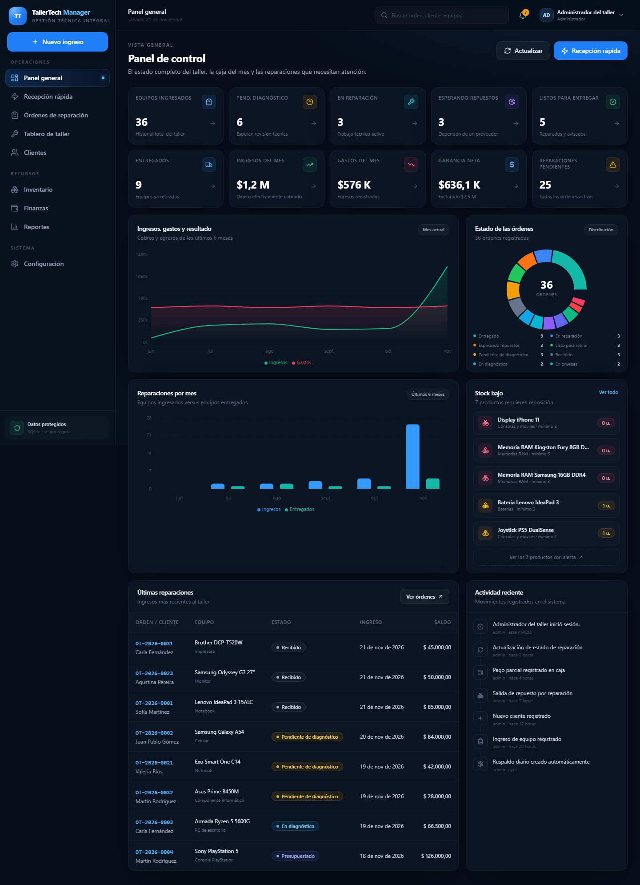
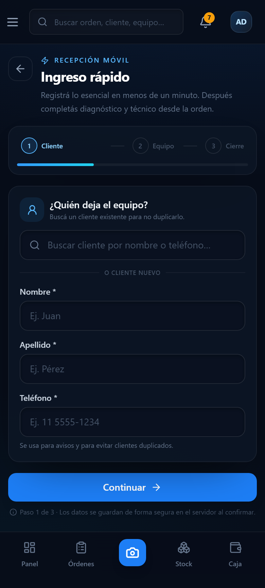

# TallerTech Manager

Sistema web de gestión integral para talleres de reparación informática y electrónica. Está desarrollado en español, con autenticación, base de datos persistente, seguimiento de reparaciones, inventario, finanzas, clientes, reportes PDF/Excel y respaldos.

> **Entrega funcional, no una maqueta.** El backend guarda los datos en SQLite, aplica validaciones y reglas de negocio, y expone una API consumida por la interfaz React.



---

## 1. Funcionalidades principales

### Panel general
- 10 indicadores: equipos ingresados, pendientes de diagnóstico, en reparación, esperando repuestos, listos para entregar, entregados, ingresos, gastos, ganancia neta y reparaciones pendientes.
- Gráficos de ingresos/gastos, reparaciones/entregas y distribución por estado.
- Últimas reparaciones, actividad reciente, alertas de stock y deudas pendientes.

### Ingreso de equipos
- Cliente existente con búsqueda por nombre, teléfono o DNI, o alta de cliente nuevo.
- Datos del equipo, accesorios, número de serie e IMEI.
- Contraseña/PIN/patrón de desbloqueo **cifrado con AES-256-GCM**.
- Falla declarada, descripción, estado físico, daños visibles, diagnóstico inicial, técnico, prioridad y observaciones.
- Hasta 6 fotografías del equipo.
- Presupuesto estimado, seña, saldo, método de pago, fecha estimada de entrega.
- Número de orden único automático (`OT-AAAA-0001`).
- Comprobante de recepción en PDF.

### Reparaciones
- Panel con búsqueda, filtros y tablero visual por etapas.
- 13 estados operativos, cada cambio registrado con fecha, hora, usuario y nota.
- Diagnóstico técnico, reparación realizada, repuestos, mano de obra, precio final e historial completo.
- Registro de pagos parciales, saldo automático, alerta al entregar con deuda.
- Búsqueda por orden, cliente, teléfono, marca, modelo, serie o IMEI.

### Inventario
- Alta/edición de productos, categorías, proveedores y ubicación física.
- Entradas, salidas y ajustes con historial de movimientos.
- Descuento automático de repuestos usados en reparaciones y restitución al quitarlos.
- Alertas de stock mínimo y productos agotados.
- Bloqueo de stock negativo salvo autorización explícita del administrador.

### Finanzas
- Ingresos por reparaciones, señas, pagos parciales, ventas y otros ingresos.
- Egresos categorizados: repuestos, herramientas, servicios, alquiler, sueldos, impuestos, etc.
- Métodos de pago: efectivo, transferencia, tarjeta, Mercado Pago y otros.
- Caja diaria y mensual, cuentas por cobrar, gráficos y reportes.
- **Facturación**, **cobrado**, **gastos** y **ganancia estimada** se calculan por separado. Una seña no se considera pago total.
- Anulación de movimientos con trazabilidad (baja lógica).

### Clientes
- Ficha con datos de contacto, observaciones, equipos, órdenes, pagos y deuda.
- Deduplicación por teléfono normalizado.
- Historial completo de reparaciones y pagos.

### Reportes
- Reparaciones realizadas, pendientes, entregadas, finanzas, repuestos usados, stock y ganancias.
- Filtros por período, estado, tipo de equipo, técnico y texto.
- Exportación a PDF (con marca del taller) y Excel (con formato y totales).

### Seguridad y administración
- Login con sesión JWT en cookie `httpOnly`, `SameSite=Strict`.
- Roles **Administrador** y **Técnico**.
- Contraseñas con bcrypt (12 rondas).
- Rate limiting básico de intentos de login.
- Auditoría de acciones en `activity_log`.
- Respaldos automáticos diarios de SQLite y respaldo JSON completo con restauración desde la interfaz.
- Los datos sensibles no se devuelven al frontend salvo acción explícita y auditada.

### Experiencia responsive y móvil
- Escritorio con menú lateral amplio y tablas.
- Tablets y celulares con menú lateral deslizable, navegación inferior, tarjetas en lugar de tablas y formularios/acciones adaptados al tacto.
- Modales tipo bottom sheet en pantallas pequeñas.
- **PWA instalable** en Android, iPhone, iPad y escritorio: se agrega a la pantalla de inicio y abre en pantalla completa.
- **Recepción rápida móvil** en 3 pasos (cliente → equipo y fotos → seña y confirmación) con acceso directo a la cámara del celular.
- Guardado automático del borrador de recepción en el dispositivo.
- Indicador de falta de conexión y app shell disponible offline (los datos requieren conexión para guardarse en el servidor).

---

## 2. Tecnologías y decisión de arquitectura

| Capa | Tecnología | Motivo |
|---|---|---|
| Frontend | React 19 + Vite | SPA rápida, componentes reutilizables, HMR en desarrollo. |
| Estilos | Tailwind CSS 3 | Diseño consistente, responsive y tema oscuro tecnológico. |
| Gráficos | Recharts | Gráficos declarativos para React. |
| Iconos | Lucide React | Iconografía clara y liviana. |
| Backend | Node.js 22+ + Express 5 | API REST sencilla de desplegar. |
| Base de datos | SQLite mediante `node:sqlite` | Persistencia relacional real, transaccional, sin servidor externo ni compilación nativa. |
| PDF | PDFKit | Comprobantes y reportes generados en el servidor. |
| Excel | ExcelJS | Exportación con formato, encabezados y filtros. |
| Auth | bcryptjs + jsonwebtoken | Hash de contraseñas y sesiones firmadas. |
| Validación | Zod | Validación y mensajes de error en español. |

### ¿Por qué SQLite y no PostgreSQL?
El enunciado pedía PostgreSQL **o una alternativa confiable**. Para un taller que puede operar en una PC local sin administrador de bases de datos, SQLite ofrece:
- persistencia real en disco,
- transacciones ACID,
- claves foráneas y relaciones,
- cero configuración externa,
- respaldos simples.

El acceso a datos está centralizado en `server/db.js` y las rutas. La migración a PostgreSQL es posible reemplazando la capa de datos y adaptando los placeholders; el esquema relacional está documentado en [`docs/ARQUITECTURA.md`](docs/ARQUITECTURA.md).

Node.js 22.5+ es requerido porque `node:sqlite` es parte del runtime. No hace falta compilar `better-sqlite3` ni instalar PostgreSQL.

---

## 3. Instalación y ejecución
### Requisitos
- Node.js **22.5 o superior** (recomendado 24).
- npm 10+.
- Sistema operativo Windows, macOS o Linux.

### Pasos

```bash
cd tallertech-manager
npm install
npm run build
npm start
```

Abrir **http://localhost:4000**.

El primer arranque crea la base, el usuario administrador y datos de demostración si no hay información previa.

### Credenciales iniciales

| Usuario | Contraseña | Rol |
|---|---|---|
| `admin` | `Admin1234!` | Administrador |

> Cambiá la contraseña desde el menú de usuario antes de usar el sistema en producción. Podés cambiar el usuario/contraseña iniciales con `ADMIN_USER` y `ADMIN_PASSWORD` **antes del primer arranque**.

### Modo desarrollo

```bash
npm run dev
```

- Frontend: http://localhost:5173 (Vite, proxy `/api` al backend)
- API: http://localhost:4000

### Instalar la app en el celular (PWA)

La app necesita **HTTPS** para instalarse y usar la cámara en producción. En local, `http://localhost` también se considera un origen seguro.

**Android (Chrome / Edge)**
1. Abrir el dominio de la app.
2. Menu del navegador → **Instalar aplicación** (o **Agregar a pantalla de inicio**).
3. También aparece un aviso de instalación dentro de la app después de unos segundos.

**iPhone / iPad (Safari)**
1. Abrir el dominio en Safari.
2. Tocar **Compartir** → **Agregar a pantalla de inicio**.
3. Confirmar “TallerTech”.

La app instalada abre en pantalla completa y la recepción rápida permite **tomar la foto del equipo directamente con la cámara**.



### Scripts

| Comando | Función |
|---|---|
| `npm run dev` | Backend con recarga + Vite en paralelo. |
| `npm run build` | Compila el frontend en `dist/`. |
| `npm start` | Inicia la app de producción (Express sirve `dist/` y la API). |
| `npm run seed` | Carga datos demo si la base está vacía. |
| `npm run db:reset` | Borra la base y las fotos, y recrea la demo. **Destructivo.** |
| `npm run vercel:api -- https://tu-api...` | Configura la URL de la API en `vercel.json`. |
| `npm test` | Suite de integración de API, PDF/Excel y respaldos. |
| `node tests/ui-smoke.mjs` | Prueba E2E de navegación y capturas con Playwright/Edge. |
| `node tests/ui-flow.mjs` | Prueba E2E de alta de orden, pago, descarga PDF y móvil. |
| `node tests/ui-mobile-pwa.mjs` | Prueba E2E de instalación PWA, service worker y recepción rápida móvil. |

---

## 4. Configuración

Copiar `.env.example` a `.env` y ajustar:

```env
PORT=4000
NODE_ENV=production
SESSION_HOURS=12
COOKIE_SECURE=false
DATA_DIR=./data
SEED_DEMO=true
ADMIN_USER=admin
ADMIN_PASSWORD=Admin1234!
# JWT_SECRET=...
# ENCRYPTION_KEY=...
```

- `SEED_DEMO=false` evita cargar datos de ejemplo en un primer arranque limpio.
- `COOKIE_SECURE=true` cuando la app se sirve por HTTPS.
- Si no se definen `JWT_SECRET` y `ENCRYPTION_KEY`, se generan aleatoriamente en `data/.secrets.json` con permisos restringidos. **Conservá ese archivo**: sin él no se pueden descifrar los datos de desbloqueo guardados.
- Si se cambian los secretos con una base ya existente, las contraseñas de desbloqueo cifradas dejan de ser legibles. Los usuarios y demás datos siguen funcionando.

### Variables de datos
- Base: `data/tallertech.db`
- Fotografías: dentro de la misma base SQLite como BLOB (se respaldan y replican junto con la base).
- Respaldos automáticos locales: `data/backups/`
- Secretos locales: `data/.secrets.json`

---

## 5. Estructura del proyecto

```text
tallertech-manager/
├─ server/
│  ├─ index.js              # Express, middleware, montaje de rutas, SPA
│  ├─ config.js             # Variables de entorno y secretos
│  ├─ db.js                 # SQLite, helpers, settings, datos base
│  ├─ schema.sql            # Esquema relacional completo
│  ├─ seed.js               # Datos de demostración
│  ├─ auth.js               # JWT, cookies, roles
│  ├─ security.js           # Cifrado AES-256-GCM
│  ├─ utils.js              # Validaciones, fechas, auditoría, constantes
│  ├─ routes/               # auth, meta, dashboard, clients, orders, inventory, finance, reports, settings
│  └─ services/             # pdf, excel, reports, backup, uploads
├─ src/
│  ├─ App.jsx / main.jsx
│  ├─ components/           # Layout, modales, tablas, badges, UI base
│  ├─ context/              # Auth y notificaciones/confirmaciones
│  ├─ hooks/                # useApiQuery, debounce
│  ├─ lib/                  # API client, formatos, constantes
│  └─ pages/                # Login, Dashboard, Órdenes, Recepción rápida, Reparaciones, Clientes, Inventario, Finanzas, Reportes, Configuración
├─ public/
│  ├─ manifest.webmanifest  # PWA instalable
│  ├─ sw.js                 # App shell / caché
│  ├─ icons/                # Íconos 192, 512 y Apple
│  └─ _redirects            # Fallback SPA para Cloudflare Pages
├─ docs/
│  ├─ ARQUITECTURA.md
│  ├─ MANUAL_USUARIO.md
│  ├─ DESPLIEGUE_CERO.md
│  ├─ DESPLIEGUE_CLOUDFLARE_SUPABASE.md
│  └─ DESPLIEGUE_VERCEL.md
├─ scripts/
│  ├─ reset-demo.mjs
│  ├─ set-vercel-api.mjs
│  └─ start-render.sh       # Litestream + API en Render Free
├─ litestream.yml           # Réplica SQLite → Supabase Storage
├─ render.yaml              # Blueprint de Render Free
├─ functions/api/[[path]].js # Proxy para Cloudflare Pages
├─ vercel.json               # Frontend Vercel + proxy externo /api
├─ tests/
│  ├─ api-smoke.test.js
│  ├─ ui-smoke.mjs
│  ├─ ui-flow.mjs
│  └─ ui-mobile-pwa.mjs
└─ data/                    # generado en runtime, no versionar
```

## Documentación

- [Arquitectura y modelo de datos](docs/ARQUITECTURA.md)
- [Manual de usuario](docs/MANUAL_USUARIO.md)
- [Despliegue gratis: Vercel Hobby + Render Free + Supabase Storage](docs/DESPLIEGUE_CERO.md)
- [Despliegue en Cloudflare Pages + Supabase](docs/DESPLIEGUE_CLOUDFLARE_SUPABASE.md)
- [Despliegue en Vercel](docs/DESPLIEGUE_VERCEL.md)
- [Capturas de la aplicación](docs/screenshots/dashboard.png)

---

## 6. Reglas de negocio implementadas

1. Cada ingreso genera un número de orden único por año.
2. Toda orden pertenece a un cliente; un cliente se identifica por teléfono normalizado para evitar duplicados.
3. Cada cambio de estado agrega una fila al historial con usuario y fecha.
4. Un repuesto agregado a una orden descuenta stock y crea un movimiento `SALIDA`; al quitarlo se restituye.
5. Los pagos crean un ingreso financiero y recalculan el saldo. La seña no se trata como pago total.
6. La anulación de pagos no borra registros: usa baja lógica y queda auditada.
7. Los gastos no afectan la facturación; se comparan contra lo cobrado para obtener el resultado de caja.
8. Los productos no pueden quedar con stock negativo salvo una autorización explícita de administrador, que queda auditada.
9. Los equipos entregados y todas sus intervenciones se conservan en el historial.
10. Las operaciones destructivas piden confirmación en la interfaz; el backend valida permisos y relaciones.

### Definiciones financieras
- **Facturación**: suma del precio final (o presupuesto si aún no hay precio final) de órdenes **entregadas** en el período.
- **Cobrado**: pagos efectivamente recibidos en el período.
- **Gastos**: egresos registrados en el período.
- **Resultado de caja**: cobrado − gastos.
- **Ganancia estimada**: facturación − costo de repuestos − costo de mano de obra registrado en las órdenes entregadas.

---

## 7. API REST

Todas las rutas (salvo login y health) requieren cookie de sesión.

| Método | Ruta | Descripción |
|---|---|---|
| POST | `/api/auth/login` | Iniciar sesión. |
| POST | `/api/auth/logout` | Cerrar sesión. |
| GET | `/api/auth/me` | Usuario actual. |
| GET | `/api/dashboard` | Estadísticas, gráficos y actividad. |
| GET/POST | `/api/clients` | Listar / crear clientes. |
| GET/PATCH/DELETE | `/api/clients/:id` | Ficha, edición y baja. |
| GET/POST | `/api/orders` | Listar / ingresar equipo. |
| GET/PATCH | `/api/orders/:id` | Detalle / edición. |
| PATCH | `/api/orders/:id/status` | Cambiar estado con historial. |
| POST | `/api/orders/:id/interventions` | Diagnóstico, reparación o nota. |
| POST/DELETE | `/api/orders/:id/parts` | Agregar/quitar repuestos con stock. |
| POST/DELETE | `/api/orders/:id/payments` | Registrar/anular pagos. |
| POST | `/api/orders/:id/reveal-unlock` | Mostrar dato cifrado (auditado). |
| GET | `/api/orders/:id/receipt.pdf` | Comprobante de recepción. |
| GET/POST | `/api/inventory/products` | Inventario. |
| POST | `/api/inventory/movements` | Entrada, salida o ajuste. |
| GET/POST | `/api/inventory/suppliers` | Proveedores. |
| GET | `/api/finance/summary` | Resumen financiero y gráficos. |
| GET/POST | `/api/finance/transactions` | Movimientos financieros. |
| GET | `/api/finance/receivables` | Cuentas por cobrar. |
| GET | `/api/reports/data` | Datos del reporte seleccionado. |
| GET | `/api/reports/export` | PDF o Excel. |
| GET/PATCH | `/api/settings` | Configuración del taller. |
| GET/POST | `/api/settings/backup` | Descargar JSON / crear snapshot. |
| POST | `/api/settings/restore` | Restaurar un respaldo JSON. |
| GET/POST/PATCH | `/api/auth/users` | Administración de usuarios (admin). |

El detalle de parámetros y respuestas está en el código de `server/routes/`.

---

## 8. Respaldos y recuperación

### Respaldos automáticos
- Se crea una instantánea SQLite al iniciar y cada 24 horas.
- Se guardan en `data/backups/`.
- Se conservan los últimos 12 archivos.
- Se pueden descargar desde **Configuración → Respaldos**.

### Respaldo JSON completo
Incluye clientes, órdenes, fotos, productos, movimientos, pagos, transacciones, usuarios, configuraciones y actividad. Se descarga desde la interfaz y puede restaurarse en línea.

### Restaurar
1. Ir a **Configuración → Respaldos**.
2. Descargar un respaldo previo como precaución.
3. Seleccionar el archivo JSON.
4. Escribir `RESTAURAR` y la contraseña del administrador.
5. La sesión se cierra y se debe ingresar nuevamente.

### Restauración manual de la base SQLite
Detener el servidor, reemplazar `data/tallertech.db` por una instantánea `.db`, y volver a iniciar. Los archivos `.db-wal` y `.db-shm` deben eliminarse junto con la base antes de copiar la instantánea.

> Los respaldos contienen información sensible. Guardalos en un lugar seguro y cifrado.

---

## 9. Seguridad

- Contraseñas nunca se guardan en texto plano.
- Datos de desbloqueo cifrados con AES-256-GCM y clave fuera de la base.
- JWT en cookie `httpOnly`, `SameSite=Strict`; expiración configurable.
- Helmet, CSP, compresión y límites de body.
- Login con bloqueo temporal después de 8 intentos fallidos en 15 minutos.
- Roles y validación de permisos en backend, no solo en UI.
- Auditoría de cambios de estado, pagos, inventario, accesos a datos sensibles y respaldos.
- No se permite stock negativo sin autorización admin.
- CORS no habilitado: la API se sirve desde el mismo origen.

Para producción:
1. Servir detrás de HTTPS (Nginx, Caddy o similar).
2. Establecer `NODE_ENV=production` y `COOKIE_SECURE=true`.
3. Definir `JWT_SECRET` y `ENCRYPTION_KEY` propios.
4. Cambiar la contraseña inicial y desactivar usuarios innecesarios.
5. Restringir permisos del sistema de archivos sobre `data/`.
6. Programar copias externas de `data/backups/`. En la variante gratis, Litestream replica la base completa a Supabase Storage.

---

## 10. Pruebas realizadas

```bash
npm test
```

Cobertura de la suite:
- autenticación y rechazo de acceso sin sesión,
- dashboard y metadatos,
- alta de cliente, orden, seña, repuesto, pago y cambio de estado,
- deduplicación de clientes,
- cifrado/descifrado del dato de desbloqueo,
- comprobante PDF,
- exportación PDF y Excel,
- finanzas, inventario y respaldo JSON,
- restauración de respaldo y nuevo inicio de sesión.

También se realizó una prueba E2E con Playwright sobre Edge, en escritorio (1440 px) y móvil (390 px), verificando navegación, modales, pestañas, descarga de comprobante y ausencia de errores JavaScript. Las capturas están en `artifacts/` durante la verificación del proyecto.

---

## 11. Despliegue en producción

### Opción A: servidor Node en una PC del taller
```bash
npm ci
npm run build
npm prune --omit=dev
NODE_ENV=production npm start
```
Se recomienda un servicio de Windows/Linux (NSSM, systemd, PM2) para reinicio automático.

### Opción B: VPS
1. Instalar Node 22+.
2. Clonar/copiar el proyecto.
3. `npm ci && npm run build`.
4. Ejecutar con systemd o PM2 detrás de Nginx con HTTPS.
5. Respaldar `data/` periódicamente.
6. Mantener un único proceso escribiendo la base SQLite; para múltiples instancias migrar a PostgreSQL.

### Variables en producción
```env
NODE_ENV=production
PORT=4000
COOKIE_SECURE=true
SEED_DEMO=false
JWT_SECRET=<64+ caracteres aleatorios>
ENCRYPTION_KEY=<hex de 64 caracteres>
```

---

## 12. Limitaciones actuales y próximos pasos

- SQLite está pensado para una única instancia. Para acceso concurrente de muchas sucursales, migrar a PostgreSQL.
- El envío de comprobantes por WhatsApp/email no está integrado; el PDF se descarga e imprime o comparte manualmente.
- No hay integración con AFIP/facturación fiscal.
- El control de caja es operativo, no contable/fiscal.
- Las fotos se guardan como BLOB dentro de SQLite; en la variante de costo cero viajan en la réplica de Litestream a Supabase Storage. Para volumen muy alto conviene migrar a un storage de objetos.
- No se implementó recuperación de contraseña por correo; un administrador puede asignar una nueva.

---

## 13. Solución de problemas

**No inicia: `node:sqlite` no encontrado.**  
Actualizar Node.js a 22.5+.

**El frontend muestra una pantalla en blanco.**  
Ejecutar `npm run build` y reiniciar `npm start`. Si se usa `npm run dev`, abrir el puerto 5173.

**No se puede descifrar un dato de desbloqueo.**  
Verificar que `data/.secrets.json` o `ENCRYPTION_KEY` sean los mismos con los que se guardó el dato.

**Error de stock insuficiente.**  
Cargar una entrada de mercadería o, como administrador, autorizar explícitamente stock negativo al agregar el repuesto.

**Se perdió la sesión al restaurar.**  
Es el comportamiento esperado: la restauración reemplaza usuarios y cierra la sesión por seguridad.

---

## 14. Créditos

Proyecto generado como aplicación full-stack completa para gestión de talleres técnicos.  
**TallerTech Manager · v1.0.0**
